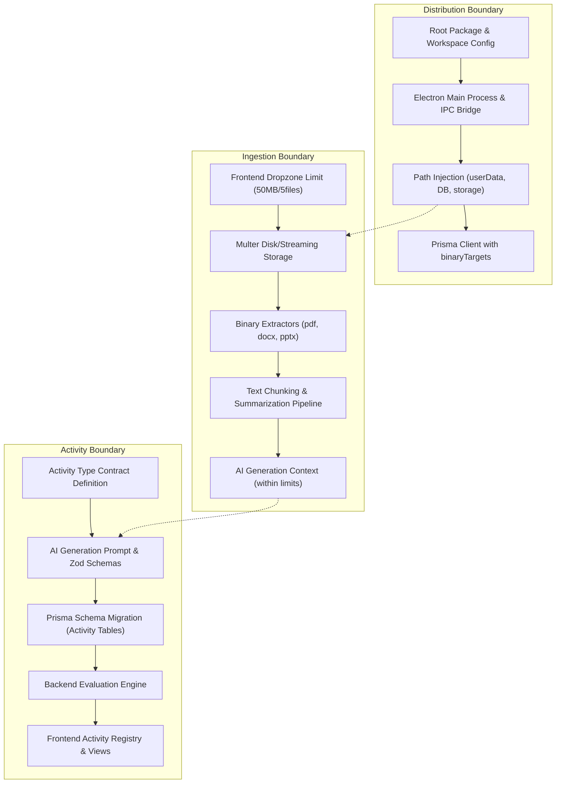

# EstudyAI — Targeted Architecture Audit for Cross-Platform Packaging, Material Ingestion, and Adaptive Activities

**Document Status:** Final Audit Report  
**Date:** October 19, 2026  
**Repository Branch:** `feat/auth-and-session-activities`  
**Working Tree Status:** Clean working directory with 5 previously modified files (read-only audit; zero application code modified)  
**Target File:** `docs/architecture/estudyai-requirements-audit.md`  

---

## 1. Executive Summary

This architecture audit evaluates the readiness of the EstudyAI codebase to support four core requirements:
1. Cross-platform distribution across Windows, Linux, and macOS.
2. Material uploads with a maximum of 50 MB per file and a maximum of 5 files per course.
3. Robust extraction and processing of uploaded study materials before AI course generation.
4. Ten contextually selected exercise types adapting to subject content without forcing inappropriate activities.

### Key Audit Findings

- **Cross-Platform Distribution (Requirement 1): NOT IMPLEMENTED / ABSENT.**  
  Despite project guidelines in `scripts-dev/AGENTE_PROMPT.md` claiming an "Electron + Electron Builder" stack, the repository contains **zero Electron code**. There is no main process, no preload script, no IPC communication layer, no packaging configuration (Electron Builder, Forge, or Vite-Electron), no root workspace orchestration, and no CI/CD packaging pipelines. The application currently exists solely as a standalone Vite/React 19 web app and a separate NestJS 10 HTTP API.
- **Data Safety in Packaged Environments: HIGH RISK / FAILS.**  
  Both the SQLite database connection (`file:./dev.db`) and uploaded materials storage (`path.join(process.cwd(), 'storage', 'materials')`) resolve relative to `process.cwd()`. In a packaged desktop application installed in protected system directories (`C:\Program Files\`, `/Applications/`, or `/opt/`), runtime write operations will fail immediately with permission denied (`EACCES`/`EROFS`). No OS user data directory separation (`app.getPath('userData')` or standard `%APPDATA%`/`XDG_DATA_HOME`) is configured.
- **Material Upload Limits (Requirement 2): PARTIALLY IMPLEMENTED / MISMATCHED.**  
  The per-file size limit is hardcoded to 5 MB (`DEFAULT_MAX_MATERIAL_BYTES = 5 * 1024 * 1024`) in the backend, configurable only via an optional environment variable. The frontend enforces no file size limit whatsoever. The requirement for a maximum of 5 files per course is **completely absent** at all layers (UI, controller, DTO, service, and database).
- **Material Extraction & Ingestion (Requirement 3): CONTRACT CONFLICT & SEVERE TRUNCATION.**  
  A major contradiction exists between frontend and backend: the frontend dropzone explicitly accepts `.pdf`, `.docx`, `.pptx`, and `.txt`, whereas backend `TextExtractionService` only accepts `.txt`, `.md`, and `.markdown`. Uploading a PDF or Word document triggers an immediate HTTP 415 error (`UNSUPPORTED_TYPE`). When text files are processed, the backend loads entire files into Node.js heap memory (`MemoryStorage`), executes synchronous regexes on the main thread, and then **silently truncates the text to 20,000 characters** for concept extraction and **8,000 characters** for session planning. Up to 99.9% of a large uploaded document is silently dropped before reaching the LLM.
- **Exercise Contracts & Adaptive Catalogue (Requirement 4): 3 OF 10 IMPLEMENTED.**  
  Only 3 activity types exist in production code: *Concept Matching*, *Step Ordering*, and *Contextualized Multiple Choice*. The remaining 7 candidate types (*Fill in the Blank*, *True/False with Justification*, *Detect an Error*, *Predict a Result*, *Classify Items*, *Short Answer*, *Branching Mini-Scenario*) are absent as distinct contracts. Furthermore, session practice activities are stored as untyped JSON strings in the database, evaluated solely on the client side, and progress is persisted only in browser `localStorage`, disconnected from user accounts and the backend database.

---

## 2. Confirmed Architecture and Repository State

### 2.1 Workspace Structure & Tooling
The repository consists of two decoupled sub-applications with an unconfigured root:
```
estudy-ai/
├── package.json                 # Unconfigured stub (no workspaces, no scripts, no dependencies)
├── backend/                     # NestJS 10 + Prisma 5.22 + Express + SQLite
│   ├── prisma/schema.prisma     # SQLite data schema
│   ├── src/                     # Modular monolith (auth, courses, sessions, quizzes, exams, materials, ai)
│   └── package.json             # Backend dependencies and Jest test suites
├── frontend/                    # Vite 8 + React 19 + TypeScript 6 + Tailwind CSS v4
│   ├── src/                     # SPA components, pages, services, i18n
│   ├── vite.config.ts           # Proxies /api to http://localhost:3000
│   └── package.json             # Frontend dependencies
└── scripts-dev/                 # Local developer agent scripts (Python 3.14 venv)
```

### 2.2 Stack Documentation Mismatch
`scripts-dev/AGENTE_PROMPT.md` (lines 8–14) states:
> - Frontend: Electron + React + TypeScript + Tailwind CSS + shadcn/ui
> - Backend: NestJS + TypeScript (API REST local)
> - Base de datos: SQLite + Prisma
> - Arquitectura: Monolito modular local
> - Empaquetado: Electron Builder → ejecutable Windows

**Code Evidence:**
1. Root `package.json` (lines 1–13) defines `"name": "estudy-ai"`, `"version": "1.0.0"`, `"main": "index.js"`, and has zero dependencies and zero workspace definitions (`"workspaces"` is missing).
2. Neither `electron`, `electron-builder`, `electron-forge`, `@electron-toolkit`, nor `@types/electron` exist in root, backend, or frontend `package.json`.
3. No shadcn/ui configuration (`components.json`) exists; the UI uses custom Tailwind CSS v4 components with Tabler Icons.
4. No desktop launcher, preload bridge, or packaging configuration file (`electron-builder.yml`, `forge.config.js`, etc.) exists anywhere in the repository.

---

## 3. Scope A — Desktop Architecture and Cross-Platform Distribution

### 3.1 Actual Architecture & Lifecycle
- **Development Startup:** Requires manual dual-terminal execution:
  - Terminal 1: `cd backend && npm run start:dev` (runs NestJS on `http://localhost:3000`).
  - Terminal 2: `cd frontend && npm run dev` (runs Vite dev server on `http://localhost:5173`).
- **Production Startup:** Completely undefined. There is no script or build artifact to start the frontend and backend together, no embedded Node.js runner, and no Electron main process to spawn or monitor the NestJS server.
- **Frontend-to-Backend Communication:**
  - In development, Vite dev server proxies `/api` requests to `http://localhost:3000` (`frontend/vite.config.ts#L8-L16`).
  - `frontend/src/services/api.ts#L7-L9` sets `API_BASE_URL` to `import.meta.env.VITE_API_URL` or falls back to `'/api'`.
  - In a packaged Electron application running from `file:///` protocols, relative `fetch('/api/...')` will fail immediately.

### 3.2 Operating System Target Status
| Operating System | Packaging Configured | Explicitly Supported | Current Verification State |
| :--- | :--- | :--- | :--- |
| **Windows** | ❌ None | ⚠️ Implicit dev OS only | Unverified for packaging; runs in dev via PowerShell |
| **Linux** | ❌ None | ❌ No | Unverified; no build targets or distribution packages |
| **macOS** | ❌ None | ❌ No | Unverified; no Apple signing, notarization, or DMG configs |

### 3.3 Backend Execution in Desktop Packaging
The backend **cannot run correctly** in a desktop package without major adaptations:
1. **Process Lifecycle:** No supervisor exists to launch `node dist/main.js`, select an available TCP port, pass the port to the frontend, detect process crashes, or send a `SIGTERM` on window close.
2. **Environment Variable Loading:** `backend/src/main.ts` does not load `.env` files via `dotenv` or `@nestjs/config`. While `@nestjs/cli` loads `.env` during `nest start`, running `node dist/main.js` inside a packaged bundle will not load environment variables unless explicitly injected by the desktop runtime.
3. **Database Migrations:** Prisma migrations are currently run via developer CLI (`npx prisma migrate dev`). Packaged desktop applications do not ship with the `prisma` CLI or `npx`. There is no programmatic migration execution (`PrismaClient.$executeRaw` or bundling `prisma migrate deploy`) during app bootstrap.

### 3.4 Data & File Storage Safety in Packaged Builds
- **Database Resolution:**
  - `backend/prisma/schema.prisma#L7`: `url = env("DATABASE_URL")`.
  - `backend/.env.example#L5`: `DATABASE_URL="file:./dev.db"`.
  - When packaged into an application directory (such as `C:\Program Files\EstudyAI` on Windows or `/Applications/EstudyAI.app` on macOS), `./dev.db` resolves to a read-only directory for non-admin users, resulting in fatal `EACCES` write crashes.
- **Material Storage Resolution:**
  - `backend/src/modules/materials/material-storage.service.ts#L26-L31`:
    ```typescript
    this.rootDir = path.resolve(
      process.env.MATERIALS_STORAGE_DIR ||
        path.join(process.cwd(), 'storage', 'materials'),
    );
    ```
  - Without an explicit `MATERIALS_STORAGE_DIR`, files are written to `process.cwd()/storage/materials`. In production, this writes directly into the binary install folder or the user's terminal launch folder, violating operating system data segregation standards.
- **Separation of Application Binaries and User Data:** Completely absent. Neither Electron's `app.getPath('userData')` nor OS standards (`%APPDATA%`, `~/.local/share`, `~/Library/Application Support`) are utilized.

### 3.5 Native Dependencies & Build Blockers
- **Prisma Client (`5.22.0`):** Relies on platform-specific C++ binary query engines. `backend/prisma/schema.prisma#L1-L3` defines:
  ```prisma
  generator client {
    provider = "prisma-client-js"
  }
  ```
  `binaryTargets` is omitted, meaning Prisma only builds engines for the host machine. Cross-platform builds (e.g. building for Linux or macOS from Windows or GitHub Actions) will fail unless `binaryTargets = ["native", "debian-openssl-3.0.x", "darwin", "darwin-arm64", "windows"]` is configured.
  Additionally, Electron Builder packages files into an archive (`app.asar`). Prisma query engines cannot execute inside an ASAR archive and **must** be extracted via `asarUnpack: ["node_modules/.prisma/**", "node_modules/@prisma/client/**"]`.
- **`bcryptjs` (`3.0.3`):** Pure JavaScript implementation; no native compilation issues across platforms.

---

## 4. Scope B — Material Upload, Storage, and Extraction

### 4.1 Layer-by-Layer Limits and Enforcement
The requirement states: **50 MB maximum per file, maximum 5 files per course**.

| Layer | File Size Limit Enforced | File Count Limit Enforced | Code Evidence |
| :--- | :--- | :--- | :--- |
| **Frontend UI** | ❌ None (no file size check) | ❌ None (no file count check) | `frontend/src/components/courses/CourseCreationForm.tsx#L24-L37` |
| **Frontend Service** | ❌ None | ❌ None | `frontend/src/services/course.service.ts#L350-L362` |
| **HTTP Interceptor** | ⚠️ Hardcoded 5 MB default | ⚠️ Max 1 file *per request* | `backend/src/modules/materials/materials.controller.ts#L39-L42` |
| **Service Layer** | ⚠️ Hardcoded 5 MB default | ❌ None (unlimited course files) | `backend/src/modules/materials/materials.service.ts#L31-L38, L70-L72` |
| **Database Schema** | ❌ `sizeBytes Int` only | ❌ No table or relation limit | `backend/prisma/schema.prisma#L43-L55` |

**Code Citation (`backend/src/modules/materials/materials.service.ts#L31-L38`):**
```typescript
export const DEFAULT_MAX_MATERIAL_BYTES = 5 * 1024 * 1024; // 5 MB, NOT 50 MB

export function getMaxMaterialBytes(): number {
  const configured = Number(process.env.MATERIALS_MAX_FILE_SIZE_BYTES);
  return Number.isInteger(configured) && configured > 0
    ? configured
    : DEFAULT_MAX_MATERIAL_BYTES;
}
```

### 4.2 Format Support Contradiction
There is a direct contradiction between frontend capability claims and backend enforcement:
- **Frontend Dropzone (`frontend/src/components/courses/FileUploadArea.tsx#L10, L116-L132`):**
  Accepts `.pdf`, `.docx`, `.pptx`, `.txt` and displays UI badges for each format.
- **Backend Extractor (`backend/src/modules/materials/text-extraction.service.ts#L18-L22, L38-L44`):**
  ```typescript
  const EXTENSION_TO_TYPE: Record<string, SupportedMaterialType> = {
    '.txt': 'txt',
    '.md': 'md',
    '.markdown': 'md',
  };
  ```
  Throws `MaterialExtractionError('UNSUPPORTED_TYPE')`, which the controller maps to HTTP 415 `UnsupportedMediaTypeException` (`materials.service.ts#L170-L175`).
- **Test Evidence (`backend/src/modules/materials/text-extraction.service.spec.ts#L28-L29`):**
  Unit tests actively verify that `.pdf` and `.docx` are rejected:
  ```typescript
  expectCode(() => service.resolveType('slides.pdf'), 'UNSUPPORTED_TYPE');
  expectCode(() => service.resolveType('doc.docx'), 'UNSUPPORTED_TYPE');
  ```
- **Conclusion:** Binary document parsing (PDF, DOCX, PPTX) is **completely unimplemented** in the backend.

### 4.3 Memory Consumption and Event Loop Blocking
1. **In-Memory Buffering:** In `materials.controller.ts#L37-L42`, `FileInterceptor('file', ...)` is instantiated without a `dest` or `storage` option. Multer stores the file entirely in RAM as a Node.js `Buffer`. If 5 files of 50 MB each are uploaded, 250 MB of raw binary data is loaded directly into the Node.js process heap.
2. **Synchronous Decoding and Regexes:** In `text-extraction.service.ts#L65, L90-L98`, the entire buffer is decoded synchronously via `new TextDecoder('utf-8', { fatal: true }).decode(buffer)`, followed by chain regex replacements:
   ```typescript
   return text
     .replace(/^\uFEFF/, '')
     .normalize('NFC')
     .replace(/\r\n?/g, '\n')
     .replace(/[^\S\n]+$/gm, '')
     .replace(/\n{3,}/g, '\n\n')
     .trim();
   ```
   Executing multi-pass regexes on a 50 MB string runs synchronously on the single Node.js main thread, freezing the event loop for multiple seconds and blocking all incoming HTTP requests.

### 4.4 Material Truncation in AI Generation
When materials pass extraction, `backend/src/modules/courses/generation-pipeline.service.ts` concatenates their content (`combinedText`, line 79). However:
- **Concept Extraction Prompt (`generation-pipeline.service.ts#L588-L595`):**
  ```typescript
  private userMessageConcepts(text: string): string {
    const maxChars = 20000;
    const truncated =
      text.length > maxChars
        ? text.slice(0, maxChars) + '\n\n[...text truncated...]'
        : text;
    return `Study material:\n\n${truncated}`;
  }
  ```
- **Session Planning Prompt (`generation-pipeline.service.ts#L632-L636`):**
  ```typescript
  const maxChars = 8000;
  const truncated =
    studyText.length > maxChars
      ? studyText.slice(0, maxChars) + '\n\n[...truncated...]'
      : studyText;
  ```
- **Impact:** A 50 MB text document contains ~10,000,000 words. The system passes only the first 20,000 characters (~4,000 words, roughly 8–10 pages) to the AI, silently discarding the remaining 99.8% of the document. No chunking, vector embedding, RAG pipeline, or hierarchical summarization exists.

### 4.5 Persistence, Lifecycle & Concurrency
- **Fire-and-Forget Execution:** `courses.service.ts#L300-L308` triggers `this.generationPipelineService.run(...)` inside `setImmediate(...)`.
- **Restart Recovery:** If the application process is closed or crashes during generation, the `GenerationJob` remains permanently stuck in `PENDING`, `EXTRACTING`, or `ANALYZING_CONCEPTS` in the SQLite database. There is no recovery or reconciliation logic in `onModuleInit` to mark interrupted jobs as `ERROR` or resume them.
- **Duplicate Materials:** The database allows identical files to be uploaded repeatedly to the same course. No content hash (SHA-256) check exists.
- **Cleanup Safety:** If database insertion fails during upload (`materials.service.ts#L100-L104`), the saved file on disk is removed. However, if course deletion fails halfway, orphan files remain on disk.

---

## 5. Scope C — Exercise Contracts, Generation, Validation, and Rendering

### 5.1 Ten-Type Compatibility Matrix

| # | Activity Type | Existing Implementation Status | Backend Generation / Schema Changes Needed | Frontend / Parser / Rendering Changes Needed | Grading & Progress Changes Needed | Relevant Tests Inspected | Main Risks & Unresolved Decisions |
| :-: | :--- | :--- | :--- | :--- | :--- | :--- | :--- |
| **1** | **Concept Matching** | **Complete** | None for practice; Final Exam prompt needs enabling (schema already supports it). | None. `MatchingActivityView.tsx` and dual-click interaction complete. | None. `evaluateMatching()` complete. | `activity.spec.ts`, `MatchingActivityView` | Long concept definitions overflow mobile/split cards; visual clutter with >5 pairs. |
| **2** | **Ordering Steps or Events** | **Complete** | None for practice; Final Exam prompt needs enabling (schema already supports it). | None. `OrderingActivityView.tsx` with up/down controls complete. | None. `evaluateOrdering()` complete. | `activity.spec.ts`, `OrderingActivityView` | AI generating non-strictly-sequential items; circular or ambiguous step dependencies. |
| **3** | **Contextualized Multiple Choice** | **Complete** | Complete in AI prompts for Challenges, Quizzes, and Final Exams. | Complete in `ActivityContainer.tsx`, `QuizQuestionCard.tsx`, and `MultipleChoiceQuestion.tsx`. | Complete. Handled on backend for quizzes and exams. | `activity.spec.ts`, `courses.service.spec.ts` | Distractor quality; ensuring explanations explain why wrong options are incorrect. |
| **4** | **Fill in the Blank** | **Absent** | Add `fill_in_the_blank` Zod schema, prompt instructions, tokens/cloze markup in DTO. | Add tokenized text parser, inline input fields or draggable chips, keyboard navigation. | Add case-insensitive, trimmed, accent-tolerant string evaluation or option-bank matching. | None (new feature) | Handling synonyms, spelling variations, and international accent marks without false negatives. |
| **5** | **True/False with Justification** | **Absent** | Add schema with boolean statement + required diagnostic justification text/selector. | Add 2-state toggle/radio + structured justification selection or explanation field. | Two-stage evaluation: grade the binary choice AND the justification match. | None (new feature) | Free-text justification requires LLM grading (expensive/slow) unless justification is selected from predefined options. |
| **6** | **Detect an Error** | **Partial** (Simulated as MC) | Create dedicated schema: code snippet/text with line numbers or token indices and bug explanation. | Add interactive code/text block with selectable line or token highlighting. | Validate selected line index/token against buggy target. | `MarkdownRenderer.spec.tsx` | Distinguishing genuine syntax/semantic bugs from formatting style variations. |
| **7** | **Predict a Result** | **Partial** (Simulated as MC) | Create dedicated schema: input parameters/code + state trace + expected output. | Add prompt presentation with input values, console/output preview panel, input field. | String/number exact match or deterministic execution comparator. | None (new feature) | Code execution cannot run arbitrary untrusted code locally without a secure sandbox (e.g. isolated-vm). |
| **8** | **Classify Items (Categorization)** | **Absent** | Add schema: $M$ category buckets + $N$ items with category mapping. | Add multi-bucket drag/drop or select-to-bucket interaction view. | Evaluate item-to-bucket assignments ($k$-of-$N$ correct score). | None (new feature) | Card layout density when categorizing 8+ items into 3+ categories on smaller screens. |
| **9** | **Short Answer** | **Absent** | Add schema: prompt, acceptable keyword lists, regex patterns, or semantic criteria. | Add multi-line textarea, character counter, submission confirmation. | Rule-based regex/keyword matching or asynchronous LLM evaluation endpoint. | None (new feature) | High risk of false negatives with rule-based matching; LLM-based grading introduces latency and API cost. |
| **10** | **Solve Mini-Scenario / Branching** | **Partial** (Single-step only) | Add multi-step state graph schema: nodes, choices, consequences, terminal outcomes. | Add multi-step wizard / branching decision tree UI with dynamic state transitions. | Path traversal grading: calculate accumulated score or optimal terminal node reachability. | None (new feature) | Exponential complexity in prompt generation; AI hallucinations in branching logic consistency. |

### 5.2 Exercise Lifecycle & Data Flow Analysis
1. **Session Guided Practice & Challenge (`Session` table):**
   - In `backend/prisma/schema.prisma#L85-L86`, `guidedPractice` and `challenge` are declared as plain `String` columns.
   - In `backend/src/modules/courses/dto/ai-course-plan.dto.ts#L34-L47`, `serializedActivityJsonSchema` accepts *any* arbitrary JSON record or raw string and serializes it to text.
   - The backend performs **no structural validation** of activity types, pairs, or options during course generation.
   - The frontend (`frontend/src/services/activity.parser.ts#L404-L500`) parses this raw JSON string via `parseOrBuildActivity()`. If the JSON is malformed, it triggers fallback synthesizers (`buildMatchingActivityFromConcepts` or `buildOrderingActivityFromContent`).
   - Evaluation is performed **100% on the client** (`evaluateMatching`, `evaluateOrdering`).
   - Progress is saved **only in browser `localStorage`** (`frontend/src/services/activity.service.ts#L101-L110`). The backend database has zero knowledge of whether a student completed a practice activity.
2. **Session Quizzes (`Quiz` & `QuizQuestion` tables):**
   - Strictly single-choice Multiple Choice (4 options, exactly 1 correct).
   - Generated by AI, validated with Zod, persisted as relational rows.
   - Evaluated on backend via `POST /quizzes/:id/attempts`. Progress persisted in `QuizAttempt` and `QuizAttemptAnswer`.
3. **Final Exams (`FinalExam` & `FinalExamQuestion` tables):**
   - Domain model (`backend/src/domain/models/final-exam.ts#L10-L33`) and evaluator (`backend/src/modules/exams/exams.service.ts#L168-L188`) support `MULTIPLE_CHOICE`, `MATCHING`, and `ORDERING`.
   - **Generation Pipeline Disconnect:** `backend/src/modules/courses/generation-pipeline.service.ts#L672-L690` hardcodes the prompt to `questions (array of MULTIPLE_CHOICE question objects)`. The exam generator never creates matching or ordering questions, despite full database and frontend rendering support.

### 5.3 Pedagogical Adaptation, Difficulty, and Repetition
- **Subject Detection:** None. Prompts do not categorize material into subject domains (e.g. STEM vs Humanities vs Language).
- **Difficulty:** Static. XP rewards (50 for intro, 20 for matching, 25 for ordering, 30 for challenge, 100 for quiz) and passing thresholds (70%) are hardcoded constants.
- **Remediation & Retries:**
  - When a student fails a quiz, `frontend/src/components/quiz/WeakConceptReview.tsx` displays summaries of missed concepts.
  - However, `course.service.ts#L318-L320` (`retryQuiz`) simply retrieves the exact same questions:
    ```typescript
    async retryQuiz(quizId: string, weakConceptIds?: string[]): Promise<Quiz> {
      void weakConceptIds; // Ignored!
      const quiz = await this.getQuiz(quizId);
    ```
  - The system does not generate new questions or adapt question difficulty on retry.

---

## 6. Scope D — Existing Architecture and Change Boundaries

### 6.1 Architectural Conventions to Preserve
1. **NestJS Clean Architecture & Dependency Injection:** Strict decoupling between controllers, domain repositories (`backend/src/domain/repositories/`), database implementations (`backend/src/database/repositories/`), and services.
2. **Zod Validation at AI Boundaries:** Using Zod schemas (`ai-course-plan.dto.ts`) to validate non-deterministic LLM JSON outputs before persistence.
3. **Strict TypeScript & React Standards:** Zero `any` policy in frontend services, comprehensive type unions, and pure component rendering.
4. **Design Tokens & Localization:** Tailwind CSS tokens (`bg-surface`, `text-primary`, `border-border`) and complete bilingual i18n support (`frontend/src/i18n/`).

### 6.2 Key Change Boundaries and Impact Analysis



1. **Local vs Systemic Changes:**
   - Changing the material file size limit to 50 MB requires modifying Multer storage mode, increasing Node.js buffer safety, adjusting HTTP request limits, and overhauling `TextExtractionService` and `GenerationPipelineService` to prevent OOM errors and event loop stalls.
   - Adding new exercise types requires updating: (a) AI generation prompts, (b) Zod response schemas, (c) Prisma schema / database persistence, (d) frontend parsers, (e) interactive React components, and (f) grading/evaluation endpoints.
2. **Conflicting Sources of Truth:**
   - `AGENTE_PROMPT.md` claims an Electron desktop app with shadcn/ui; actual codebase is a web SPA without Electron.
   - Frontend claims `.pdf`/`.docx`/`.pptx` support; backend explicitly throws 415 errors and asserts rejection in unit tests.
   - Final exam domain supports 3 question types; generation pipeline strictly enforces 1 type.
   - Session activity progress is stored in browser `localStorage`, whereas quiz and exam progress is stored in the backend SQLite database.

---

## 7. Relevant Source Files and Precise Line References

### Desktop & Packaging Scope
- `package.json#L1-L13`: Unconfigured root stub; missing workspaces and Electron dependencies.
- `frontend/package.json#L6-L12, L13-L22`: Vite React scripts and dependencies; no Electron wrapper.
- `backend/package.json#L8-L21, L22-L35`: NestJS scripts and dependencies; no Electron runner.
- `backend/src/main.ts#L5-L15`: Backend bootstrap without `.env` loader or process supervisor.
- `backend/src/app.config.ts#L11-L19`: CORS defaults hardcoded to `http://localhost:5173`.
- `backend/prisma/schema.prisma#L1-L8`: SQLite datasource using relative `env("DATABASE_URL")` with missing `binaryTargets`.
- `backend/src/database/prisma.service.ts#L1-L17`: Prisma client connection lifecycle.
- `frontend/vite.config.ts#L8-L16`: Proxy configuration from `/api` to `http://localhost:3000`.
- `frontend/src/services/api.ts#L7-L9`: Base API URL fallback to relative `'/api'`.

### Material Ingestion Scope
- `frontend/src/components/courses/FileUploadArea.tsx#L10, L116-L132`: Frontend claiming `.pdf`, `.docx`, `.pptx`, `.txt` support.
- `frontend/src/components/courses/CourseCreationForm.tsx#L24-L37, L53-L67`: Absence of file count and file size limits.
- `frontend/src/services/course.service.ts#L350-L362`: Sequential file upload loop.
- `backend/src/modules/materials/materials.controller.ts#L37-L42`: Multer memory storage and file limit interceptor.
- `backend/src/modules/materials/materials.service.ts#L31-L38`: 5 MB default limit configuration (`DEFAULT_MAX_MATERIAL_BYTES`).
- `backend/src/modules/materials/materials.service.ts#L49-L73`: File validation logic (absence of course file count check).
- `backend/src/modules/materials/text-extraction.service.ts#L18-L22, L38-L44`: Extension restriction to `.txt` and `.md` only.
- `backend/src/modules/materials/text-extraction.service.ts#L63-L98`: UTF-8 decoding and synchronous regex normalization.
- `backend/src/modules/materials/material-storage.service.ts#L26-L31, L53-L58`: File path resolution relative to `process.cwd()`.
- `backend/src/modules/materials/text-extraction.service.spec.ts#L27-L32`: Tests asserting rejection of `.pdf` and `.docx`.
- `backend/src/modules/courses/generation-pipeline.service.ts#L588-L595`: Truncation to 20,000 characters for concept extraction.
- `backend/src/modules/courses/generation-pipeline.service.ts#L632-L636`: Truncation to 8,000 characters for session planning.
- `backend/src/modules/courses/courses.service.ts#L300-L308`: `setImmediate` fire-and-forget pipeline execution.

### Exercise Contracts Scope
- `backend/src/modules/courses/dto/ai-course-plan.dto.ts#L34-L76`: Untyped serialized JSON schema for session practice activities.
- `backend/src/modules/courses/dto/ai-course-plan.dto.ts#L130-L173`: Final exam multiple-choice schema.
- `backend/src/domain/models/final-exam.ts#L10-L33`: Domain types for `MULTIPLE_CHOICE`, `MATCHING`, and `ORDERING`.
- `backend/src/modules/exams/exams.service.ts#L168-L188, L268-L282, L327-L355`: Backend evaluation for multiple choice, matching, and ordering in exams.
- `backend/src/modules/courses/generation-pipeline.service.ts#L672-L690`: Prompt restricting final exam generation exclusively to multiple choice.
- `frontend/src/types/activity.ts#L6-L68`: Frontend activity union type (`matching`, `ordering`, `multiple_choice`).
- `frontend/src/services/activity.parser.ts#L29-L78`: Matching activity validator.
- `frontend/src/services/activity.parser.ts#L83-L142`: Ordering activity validator.
- `frontend/src/services/activity.parser.ts#L147-L244`: Multiple choice activity validator.
- `frontend/src/services/activity.parser.ts#L404-L500`: `parseOrBuildActivity()` fallback synthesizers.
- `frontend/src/components/activity/ActivityContainer.tsx#L55-L98, L292-L338`: Practice activity interactive views and state handling.
- `frontend/src/services/activity.service.ts#L27-L56, L88-L110`: Client-side `localStorage` progress persistence.
- `frontend/src/services/course.service.ts#L318-L320`: Quiz retry mechanism ignoring weak concepts and serving identical questions.

---

## 8. Confirmed Facts vs Inferences and Unknowns

| Category | Item | Evidence & Verification |
| :--- | :--- | :--- |
| **Confirmed Fact** | Electron is absent from the repository. | Verified: No Electron files, dependencies, or packaging configs found in git tracked files. |
| **Confirmed Fact** | Backend rejects PDF, DOCX, and PPTX files. | Verified: `text-extraction.service.ts#L18-L22` throws 415; verified by unit tests in `text-extraction.service.spec.ts#L28-L29`. |
| **Confirmed Fact** | File size default limit is 5 MB, not 50 MB. | Verified: `DEFAULT_MAX_MATERIAL_BYTES = 5 * 1024 * 1024` in `materials.service.ts#L31`. |
| **Confirmed Fact** | 5 files per course limit is absent. | Verified: No checks in frontend, controller, DTO, service, or database schema. |
| **Confirmed Fact** | Large files are truncated to 20,000 / 8,000 chars. | Verified: Hardcoded limits in `generation-pipeline.service.ts#L589, L633`. |
| **Confirmed Fact** | Practice activity progress is stored only in localStorage. | Verified: `activity.service.ts#L101-L110` writes to `localStorage`; no DB model or API endpoint exists. |
| **Confirmed Fact** | Only 3 of 10 exercise types exist. | Verified: `types/activity.ts` and `activity.parser.ts` only recognize matching, ordering, and multiple choice. |
| **Inference** | Concurrent 50 MB uploads will trigger OOM on standard machines. | Node.js default memory limits combined with Multer `MemoryStorage` buffer duplication across requests typically exhausts 1–2 GB heap memory. |
| **Inference** | Cross-compiling for Linux/macOS from Windows will fail Prisma engine resolution. | Prisma client without `binaryTargets` does not download foreign query engine binaries. |
| **Unknown** | Whether offline desktop operation requires bundled local LLMs. | `AiService` currently depends exclusively on the OpenAI cloud API (`https://api.openai.com/v1`). |
| **Unknown** | Exact pedagogical rules for selecting exercise types per subject. | No curriculum taxonomy or subject-to-exercise mapping rules currently exist in the repository. |

---

## 9. Risk Assessment and Prioritization

### Critical Risks (Immediate Architectural Blockers)
1. **Desktop Shell Absence:**  
   The application cannot be distributed as a desktop installer for Windows, Linux, or macOS. Major architectural setup (Electron/Tauri wrapper, IPC bridge, process supervisor) is required from scratch.
2. **Packaged Filesystem Permissions Crash:**  
   Database (`dev.db`) and material files (`storage/materials`) write to `process.cwd()`. In any standard OS installation directory (`C:\Program Files`, `/Applications`), the app will crash on first write due to permission denial (`EACCES`).
3. **Severe Material Truncation (Silent Content Loss):**  
   Materials are truncated to 20,000 characters for concept extraction and 8,000 characters for session planning. Uploading large materials results in courses generated from only the first few pages, misleading the user without any warning.
4. **Format Ingestion Contradiction:**  
   The frontend invites users to upload `.pdf` and `.docx`, but the backend immediately rejects them with an HTTP 415 error, breaking the primary onboarding flow.

### High Risks (System Stability & Functional Gaps)
5. **Memory Exhaustion & Event Loop Stalls:**  
   Multer `MemoryStorage` and synchronous UTF-8 decoding / regex normalization of 50 MB files will block the Node.js event loop or cause Out-Of-Memory (OOM) crashes under concurrent uploads.
6. **Orphaned Generation Jobs on Process Termination:**  
   In-memory `setImmediate` execution means terminating the app while generating leaves the course permanently locked in `PROCESSING` status with no auto-recovery on restart.
7. **Client-Side Only Practice Progress:**  
   Practice activity progress is saved only in browser `localStorage`. Logging in from another browser, clearing data, or switching accounts loses all activity completion status.

### Medium Risks (Design Inconsistencies & Pedagogical Limitations)
8. **Static Quiz Retries:**  
   Failing a quiz and selecting "Reintentar" serves the exact same questions with no regeneration or remediation.
9. **Final Exam Question Type Disconnect:**  
   Final Exam models and evaluators support matching and ordering questions, but the AI generation prompt restricts exams to multiple choice only.
10. **Duplicate Material Ingestion:**  
    No hash-based deduplication allows identical files to be saved repeatedly, wasting storage.

---

## 10. Open Architectural Decisions

1. **Desktop Packaging Technology:**  
   Should the project use **Electron** (as stated in prompt documentation) or **Tauri** (lighter footprint, lower RAM consumption for bundling a NestJS/Node server or migrating to a Rust core)? If Electron is chosen, should the backend run as a bundled Node.js child process or be refactored into Electron background workers?
2. **User Data Directory Injection:**  
   How should the Electron main process provide the writable `userData` path to NestJS? (Recommended: via injected environment variables `ESTUDY_DATA_DIR` at child process launch).
3. **Database Migration Strategy in Distribution:**  
   How will SQLite schema migrations run on the user's desktop without `prisma-cli`? (Options: programmatic migration runner via Prisma engine or pre-migrated SQLite seed template copied to `userData` on first run).
4. **Document Extraction Engine:**  
   Which native or pure-JS parsing libraries should be adopted for PDF (`pdf-parse` vs `pdfjs-dist`), Word (`mammoth`), and PowerPoint (`adm-zip` XML parser)? How should image-only / scanned PDFs be handled (OCR integration or graceful error notification)?
5. **Content Chunking & AI Context Strategy:**  
   Given model token limits, how should 50 MB of extracted text be structured for AI ingestion? (Options: hierarchical summarization, map-reduce concept extraction, or local vector embeddings with retrieval).
6. **Activity Persistence Model:**  
   Should session activities remain lightweight JSON strings with progress in `localStorage`, or should a formal `ActivityAttempt` relational schema be migrated into Prisma for account-wide synchronization?
7. **Catalogue Adaptation Rules:**  
   What criteria will the AI generator use to omit unsuitable exercise types (e.g. omitting ordering exercises when material contains no sequential processes)?

---

## 11. Recommended Next Steps in Dependency Order

### Phase 1: Storage, Ingestion, and Data Safety (Prerequisite to Packaging)
1. **Configure Data Paths:** Refactor `PrismaService` and `MaterialStorageService` to resolve database and file storage paths from an overridable environment variable (`ESTUDY_USER_DATA_DIR`), defaulting to OS user data standards rather than `process.cwd()`.
2. **Enforce 50 MB & 5 Files Limits:** Update `materials.controller.ts` and `CourseCreationForm.tsx` to uniformly validate that:
   - Each file is $\le 50\text{ MB}$.
   - The total number of materials per course does not exceed 5.
3. **Migrate Multer to Disk / Streaming Storage:** Replace `MemoryStorage` with temporary disk streaming to eliminate Node.js heap memory exhaustion during large uploads.
4. **Implement Binary Text Extractors:** Integrate robust extractors for PDF (`pdf-parse`) and DOCX (`mammoth`), aligning backend capabilities with the frontend dropzone.
5. **Implement Material Chunking / Summarization:** Replace hardcoded character truncation (`maxChars = 20000`) with a multi-stage chunked extraction pipeline to process the full content of uploaded documents.

### Phase 2: Desktop Packaging Architecture
6. **Establish Monorepo Workspaces:** Update root `package.json` with npm/pnpm workspaces for `frontend`, `backend`, and a new `desktop` package.
7. **Build Electron Shell & Lifecycle Manager:** Implement `electron/main.ts` with secure `preload.ts` (`contextBridge`), automatic backend child process spawning, dynamic port discovery, and graceful shutdown handling.
8. **Configure Prisma Query Engine Bundling:** Add target platforms to `schema.prisma` `binaryTargets` and configure `asarUnpack` in Electron Builder.
9. **Automate Startup Migrations:** Implement programmatic SQLite database initialization and migrations upon application launch.
10. **Create Platform Distribution Configurations:** Set up Electron Builder configurations for Windows (NSIS installer), Linux (AppImage / .deb), and macOS (DMG with codesign/notarization stubs).

### Phase 3: Exercise Catalogue Evolution
11. **Harmonize Final Exam Question Types:** Update `systemPromptFinalExam` in `generation-pipeline.service.ts` to allow generating `MATCHING` and `ORDERING` exam questions.
12. **Define Formal Activity Contracts:** Transition session activities from untyped JSON strings into structured, validated schema definitions with dedicated backend attempt tracking.
13. **Implement Candidate Exercise Types Incrementally:**
    - *Tier 1 (High Pedagogical Value, Low Complexity):* Fill in the Blank, True/False with Justification, Classification.
    - *Tier 2 (Domain-Specific / Interactive):* Detect an Error, Predict a Result.
    - *Tier 3 (Complex State Management):* Branching Mini-Scenarios, Short Answer with Semantic Evaluation.
14. **Implement Subject-Adaptive Selection Logic:** Provide prompt guidelines instructing the LLM to choose exercise types based on material structure (e.g. ordering only for workflows, code prediction only for programming topics).
